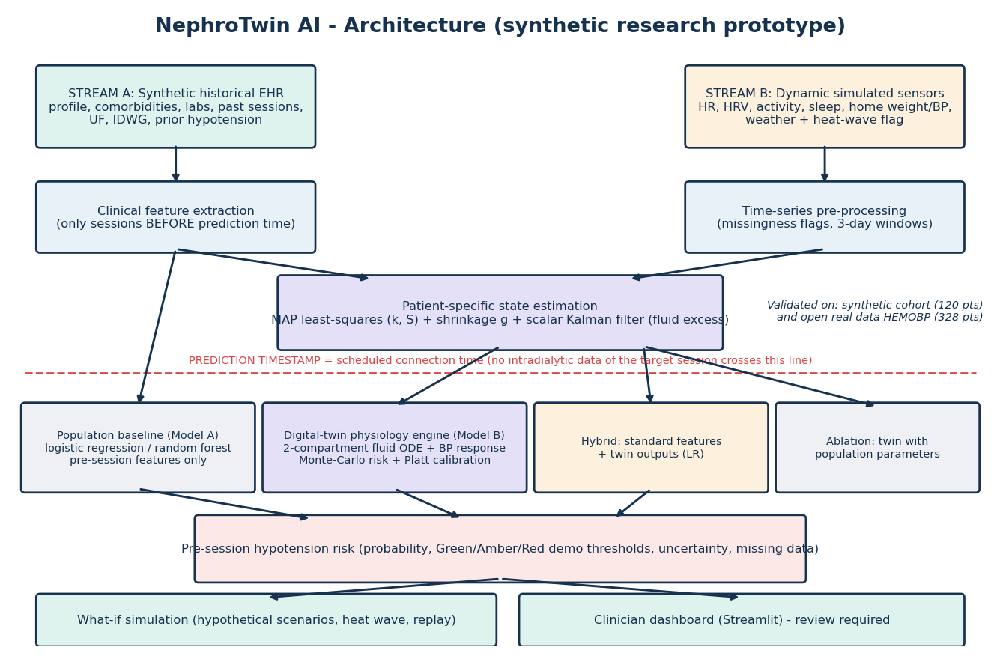
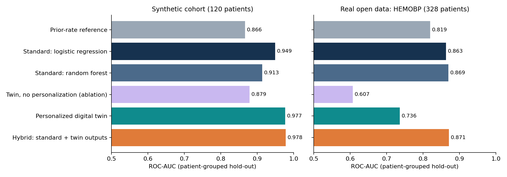
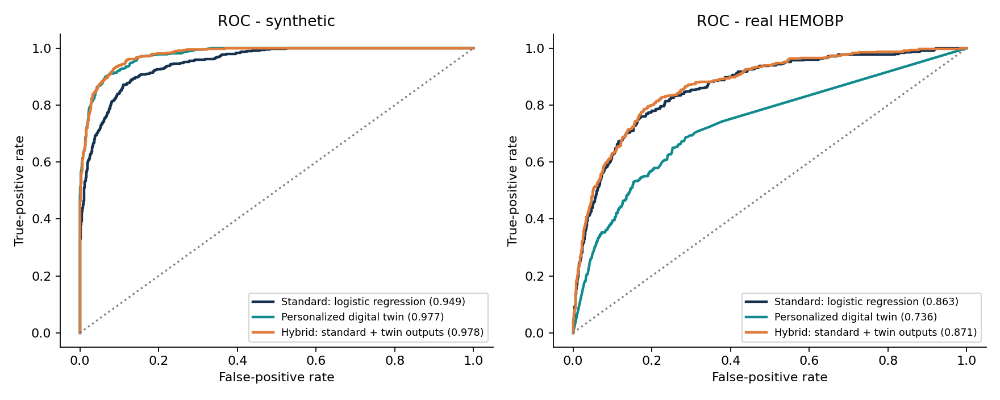
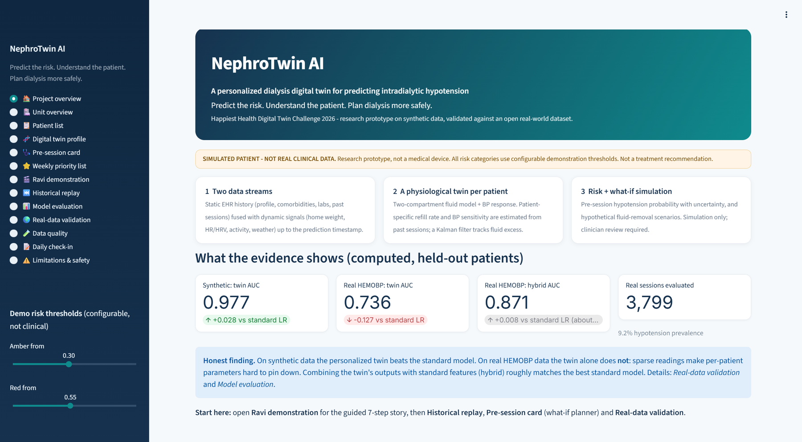
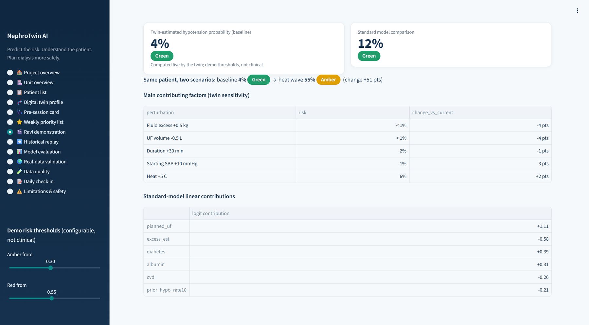
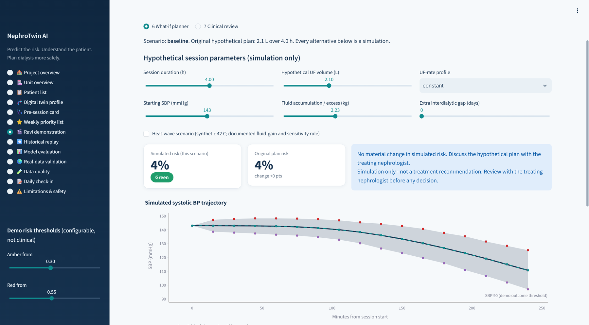
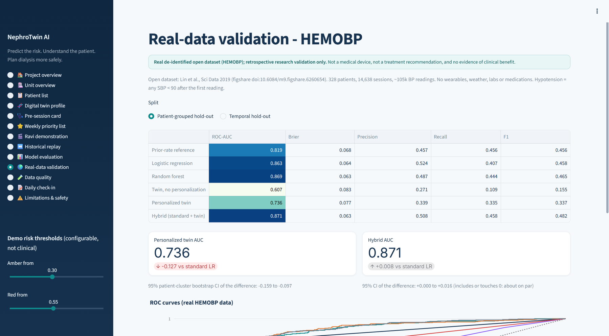

<div align="center">

# NephroTwin AI
**A Personalized Dialysis Digital Twin for Predicting Intradialytic Hypotension and Supporting Safer Fluid Removal Planning**

*Predict the risk. Understand the patient. Plan dialysis more safely.*

   

</div>

> **Simulated research prototype.** Synthetic patients are labelled everywhere. Not a medical device, not clinically validated, not a treatment recommendation system.

**Competition:** Happiest Health Digital Twin Challenge 2026 &nbsp;·&nbsp; **Team:** ZWEIKERN &nbsp;·&nbsp; **License:** MIT

## Quick links for judges

| What | Where |
|---|---|
| GitHub repository (public) | https://github.com/Shada0/NephroTwin-AI |
| YouTube demo video (unlisted) | `[INSERT YOUTUBE UNLISTED VIDEO LINK HERE]` |
| Pitch deck (Google Drive) | `[INSERT GOOGLE DRIVE PITCH DECK LINK HERE]` |
| Pitch deck (PDF in this repo) | [`presentation/project_presentation.pdf`](presentation/project_presentation.pdf) |
| Architecture diagram | [`docs/architecture_diagram.pdf`](docs/architecture_diagram.pdf) |
| Run the app | `streamlit run app.py` (or Docker, see section 13) |

## Submission details (mandatory README items)

### Team details
- **Team name:** ZWEIKERN
- **Team members:**
  - **Shada Ali Kuzhikattil** - Lead Architect / AI Engineer
  - **Rushdha V** - Clinical Informatics & UI/UX

### College / Incubator information
- **College:** Vel Tech Rangarajan Dr. Sagunthala R&D Institute of Science and Technology, Chennai, India

### Project Title
**NephroTwin AI - A Personalized Dialysis Digital Twin for Predicting Intradialytic Hypotension and Supporting Safer Fluid Removal Planning**

### Problem Statement
Maintenance hemodialysis removes fluid that accumulates between sessions, and removing it too fast can cause intradialytic hypotension (a dangerous fall in blood pressure during treatment). Risk differs from patient to patient and session to session, but routine scores are population-level and do not reflect an individual's fluid-refill and blood-pressure response. The challenge: predict, **before** a session, the patient-specific risk of hypotension from historical records plus dynamic observations, and let clinicians explore hypothetical plans safely.

### Healthcare Use Case
Chronic kidney disease on maintenance hemodialysis. Before the next session, the care team (nephrologists, dialysis technicians, unit staff, researchers) sees a risk estimate (Green/Amber/Red demo thresholds) with contributing factors, uncertainty and missing-data flags, plus a what-if planner for hypothetical duration / fluid-removal / heat-wave scenarios. Outputs are simulations - not treatment orders; clinical review is always required.

### Technical Stack
Python 3.10+ · NumPy · pandas · SciPy (ODE integration, nonlinear least squares) · scikit-learn · Plotly · Streamlit · matplotlib / reportlab (report assets) · pytest · GitHub Actions CI · Docker. A scalar Kalman filter is implemented by hand (no Kalman library). Details: `requirements.txt`.

### AI/ML Model or Framework Details
- **Standard (population) model:** logistic regression and random forest (scikit-learn) on 30 pre-session features.
- **Personalized digital twin:** two-compartment fluid ODE (SciPy `solve_ivp`) + blood-pressure response; patient parameters (refill rate, BP sensitivity, fluid-gain rate) via MAP nonlinear least squares with an empirical-Bayes prior learned from training patients; Kalman-filtered fluid state; Monte-Carlo risk; Platt calibration.
- **Hybrid:** logistic regression on the standard features plus twin outputs. **Ablation:** twin with population-average parameters.
- **Evaluation:** patient-grouped and temporal hold-outs, bootstrap CIs, on a synthetic cohort and on the real open HEMOBP dataset. Model card: `docs/model_card.md`; results: [`docs/results.md`](docs/results.md).

### Demo Video
**Unlisted YouTube link (15-20 minutes): `[INSERT YOUTUBE UNLISTED VIDEO LINK HERE]`**
Recording script with timestamps (20:00 total): [`docs/demo_script.md`](docs/demo_script.md).

### Open-source License Details
**MIT License** - see [`LICENSE`](LICENSE). Copyright holder: Zweikern. The real HEMOBP dataset used for validation is **not** redistributed here; see its source license (figshare doi:10.6084/m9.figshare.6260654) and `docs/real_data.md`.

### Architecture Diagram
PDF: [`docs/architecture_diagram.pdf`](docs/architecture_diagram.pdf) · PNG preview below · equations in [`docs/architecture.md`](docs/architecture.md)



### Presentation
14-slide pitch deck (problem, twin, evidence, dashboard, business case, market, regulatory roadmap, safety): [`presentation/project_presentation.pdf`](presentation/project_presentation.pdf) · PowerPoint: [`presentation/NephroTwin_AI_Pitch_Deck.pptx`](presentation/NephroTwin_AI_Pitch_Deck.pptx) · Google Drive: `[INSERT GOOGLE DRIVE PITCH DECK LINK HERE]`

### Public accessibility
- Repository (public): https://github.com/Shada0/NephroTwin-AI
- The repository, both PDFs and the YouTube video are meant to open without logging in.

---

## At a glance
- **Condition / event:** maintenance hemodialysis -> intradialytic hypotension (demo label: any monitored SBP < 90 mmHg), predicted **before** the session.
- **Digital twin:** per-patient two-compartment fluid + blood-pressure model; parameters estimated from past sessions with uncertainty; Kalman-filtered fluid state; Monte-Carlo risk; what-if simulation.
- **Data:** static EHR stream + dynamic sensor/weather stream (synthetic, 120 patients) **and validation on a real open dataset (HEMOBP, 328 patients, 14,638 sessions)**.
- **Honest result:** the twin beats a standard model on synthetic data, but **not** on real data; a hybrid (standard features + twin outputs) is on par with the best standard model there. Details below.
- **Dashboard:** 13-view Streamlit app, guided "Ravi" demo, historical replay, planner, evaluation, real-data validation.

## 1. Problem statement
Dialysis removes fluid that accumulates between sessions; removing it too quickly can cause a dangerous blood-pressure fall (intradialytic hypotension). Risk is patient- and session-specific, yet routine scores are population-level.

## 2. Healthcare use case
Before the next session, show the care team a patient-level risk estimate with its reasons and uncertainty, and let them explore *hypothetical* fluid-removal scenarios. Users: nephrologists, dialysis technicians, unit care teams, researchers.

## 3. Digital-twin concept
Each patient has a persistent virtual state: refill rate **k**, BP sensitivity **S**, fluid-accumulation rate **g**, HR response, and a Kalman-filtered **fluid-excess** estimate - all with uncertainty. The twin is initialised from history, updated as observations arrive, and used to *simulate* the upcoming session. See `docs/architecture.md` for equations.

## 4. Static data stream
Age, sex, diabetes, hypertension, CVD, CKD status, baseline BP, dry weight, labs, BP-medication categories, six months of sessions (UF, duration, weights, IDWG, timed BP/HR, hypotension, saline, UF pause, early termination).

## 5. Dynamic data stream
Daily home weight and BP (partly missing), wearable HR / HRV / activity / sleep (~20% missing), temperature and heat-wave flag, pre-dialysis vitals. BP is a simulated cuff reading - wearables are **not** claimed to measure BP or fluid removal.

## 6. Prediction target
Hypotension-positive = any monitored SBP < 90 mmHg (simplified research definition). Prediction timestamp = scheduled connection time; the twin for session *n* uses only sessions < *n*; tests assert that outcome columns never enter features. Green/Amber/Red thresholds are configurable demo values.

## 7. Architecture
See the **Architecture Diagram** section above (PDF: `docs/architecture_diagram.pdf`) and `docs/architecture.md`.

## 8. Technical stack
Python 3.10+, NumPy, pandas, SciPy (ODE integration, least squares), scikit-learn, Plotly, Streamlit, pytest, matplotlib/reportlab (report assets). A scalar Kalman filter is hand-written; no SHAP/LightGBM/Kalman libraries are used (exact linear contributions and finite-difference twin sensitivities are used instead; none are causal).

## 9. Data methodology
**Synthetic cohort** (`src/data/synthetic_generator.py`, seed 42): 120 patients incl. demo patient "Ravi", 26 weeks, ~8.4k sessions. Latent parameters depend on diabetes, CVD, age, albumin, medications; outcomes come from a physiological simulation with AR(1) noise, session-to-session variability and **deliberate misspecification** relative to the twin (quadratic BP response, drift, dry-weight error). Heat rule: +5% daily fluid gain per °C above 32 °C, +15% BP sensitivity at full heat stress. Data dictionary: `docs/data_dictionary.md`.

**Real open data - HEMOBP** (Lin et al., *Sci Data* 2019, doi:10.1038/s41597-019-0319-8; figshare doi:10.6084/m9.figshare.6260654; article CC BY 4.0 - confirm the data license on figshare; **not bundled**): real intradialytic SBP/DBP, UF rate, weights, dry weight. No wearables, weather, labs or medications. Leakage controls (initial UF only as the plan; duration from prior sessions) and mapping: `docs/real_data.md`.

## 10. Model comparison
Standard (logistic regression, random forest) vs personalized twin vs hybrid, plus ablation (twin without personalization) and a prior-rate reference. The twin's population prior is **learned from training patients only** (empirical Bayes), not hand-set.

## 11. Evaluation results (computed from `models/evaluation*.json`, never hand-typed)

<!--RESULTS_START-->
### Synthetic cohort - patient-grouped hold-out

| Model | ROC-AUC | Brier | Precision | Recall | F1 |
|---|---|---|---|---|---|
| Prior-rate reference | 0.866 | 0.117 | 0.60 | 0.69 | 0.64 |
| Standard: logistic regression | 0.949 | 0.074 | 0.80 | 0.73 | 0.77 |
| Standard: random forest | 0.913 | 0.098 | 0.76 | 0.66 | 0.71 |
| Twin, no personalization (ablation) | 0.879 | 0.116 | 0.61 | 0.70 | 0.65 |
| Personalized digital twin | 0.977 | 0.050 | 0.85 | 0.87 | 0.86 |
| Hybrid: standard + twin outputs | 0.978 | 0.049 | 0.85 | 0.87 | 0.86 |

*36 test patients, 2,379 sessions, outcome prevalence 23.5%. AUC difference vs logistic regression (95% patient-cluster bootstrap CI): twin +0.028 (+0.015 to +0.043); hybrid +0.030 (+0.016 to +0.047).*

### Real open data (HEMOBP) - patient-grouped hold-out

| Model | ROC-AUC | Brier | Precision | Recall | F1 |
|---|---|---|---|---|---|
| Prior-rate reference | 0.819 | 0.068 | 0.46 | 0.46 | 0.46 |
| Standard: logistic regression | 0.863 | 0.064 | 0.52 | 0.41 | 0.46 |
| Standard: random forest | 0.869 | 0.063 | 0.49 | 0.44 | 0.46 |
| Twin, no personalization (ablation) | 0.607 | 0.083 | 0.27 | 0.11 | 0.16 |
| Personalized digital twin | 0.736 | 0.077 | 0.34 | 0.34 | 0.34 |
| Hybrid: standard + twin outputs | 0.871 | 0.063 | 0.51 | 0.46 | 0.48 |

*87 test patients, 3,799 sessions, outcome prevalence 9.2%. AUC difference vs logistic regression (95% patient-cluster bootstrap CI): twin -0.127 (-0.159 to -0.097); hybrid +0.008 (+0.000 to +0.016).*




<!--RESULTS_END-->

**Reading these results.** Synthetic: twin > standard, but the twin's structure resembles the data generator, so this is optimistic. Real: the twin alone is worse than the standard model (sparse readings, median 6 per session, make per-patient parameters hard to identify); the hybrid is about equal. In both datasets personalization beats the ablation. Retrospective results never establish clinical benefit.

## 12. Demo instructions
```bash
streamlit run app.py
```
Open **Ravi demonstration** (7 steps; enable the heat wave in step 3), then **Historical replay**, **Pre-session card** (what-if planner), **Model evaluation**, **Real-data validation**. Video script: `docs/demo_script.md`.

## 13. Installation
```bash
git clone https://github.com/Shada0/NephroTwin-AI.git && cd NephroTwin-AI
python -m venv .venv && source .venv/bin/activate
pip install -r requirements.txt
python -m src.cli generate   # synthetic data
python -m src.cli train      # baseline + twin predictions (~2 min)
python -m src.cli evaluate   # metrics -> models/evaluation.json
python -m src.make_report    # figures + README tables
python -m pytest -q
streamlit run app.py
```
Pre-generated data and models are included. Docker: `docker build -t nephrotwin . && docker run -p 8501:8501 nephrotwin`.

**Real-data reproduction:** download the figshare files (`idp.csv`, `d1.csv`, `vip.csv`) into a folder, then `python -m src.cli real <folder> 1100` (set `TWIN_BUDGET=90` to run in resumable ~90 s slices; re-run until done).

## 14. Screenshots

| Project overview | Ravi guided demo (heat wave: 4% -> 55% simulated risk) |
|---|---|
|  |  |

| What-if planner (simulation only) | Real-data validation (HEMOBP) |
|---|---|
|  |  |

## 15. Limitations
`docs/clinical_limitations.md`: synthetic data, simplified physiology, circularity, thresholds, uncertainty, real-data underperformance of the twin alone, bias, missing sensors, planner is simulation only, retrospective results cannot show benefit.

## 16. Future scope
Prospective validation with richer data; hierarchical Bayesian pooling and better observation models to improve identifiability; usability study with clinicians; real wearable/weather feeds; calibration monitoring.

## 17. License
MIT License, Copyright (c) 2026 Zweikern - see `LICENSE`.

## 18. Citation and acknowledgements
Real-data validation uses: Lin CJ, Chen YY, Pan CF, Wu V, Wu CJ. *Dataset supporting blood pressure prediction for the management of chronic hemodialysis.* Sci Data 6, 313 (2019). doi:10.1038/s41597-019-0319-8; data: Wu CJ (2018) HEMOBP, figshare, doi:10.6084/m9.figshare.6260654. Physiological constants in the synthetic generator are illustrative and not drawn from a cited source. Built by team **ZWEIKERN** (Shada Ali Kuzhikattil, Rushdha V), Vel Tech Rangarajan Dr. Sagunthala R&D Institute of Science and Technology, Chennai, for the Happiest Health Digital Twin Challenge 2026. Thanks to the HEMOBP authors for releasing an open dataset.
